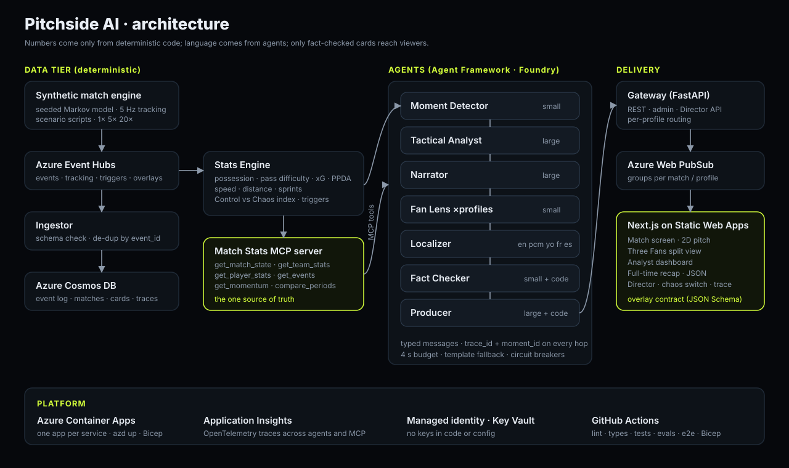

# Pitchside AI

**Every fan saw the same goal. Pitchside AI tells each one a different story.**

Pitchside AI is a multi-agent system that watches a football match as it happens and turns
raw events into live, explained, personalised match intelligence:

1. **Ingest**: our own synthetic match engine streams fictional match events and 5 Hz player
   tracking in real time.
2. **Interpret**: a deterministic Stats Engine turns them into numbers: possession, pass
   accuracy and difficulty, shot speed, distance covered, xG, PPDA and a **Control vs Chaos**
   momentum index.
3. **Explain**: seven AI agents built with **Microsoft Agent Framework** on **Microsoft
   Foundry** models spot the moments that matter and explain *why*, reading every number
   through one **MCP** server.
4. **Render**: a Producer agent emits timed, machine-readable overlay cards onto a live 2D
   match view.
5. **Personalise**: a Fan Lens agent rewrites each insight for each viewer (analyst, casual
   fan, Player Cam, kids; favourite club and player) and a Localizer delivers it in
   **English, Nigerian Pidgin, Yorùbá, French or Spanish**.

A **Fact Checker** blocks any card whose numbers do not match match state, and if a model is
slow, failing or switched off the screen falls back to stats-only cards and never goes blank.

Everything runs on invented clubs and players. No real league, club or player data is used
anywhere.

> **Demo:** _(public URL once deployed with `azd up`)_ · **Video:** _(2-minute demo, link to come)_



## Try it locally (no Azure account, no model needed)

```bash
docker compose up --build        # then open http://localhost:8000
```

Or without Docker (needs [uv](https://docs.astral.sh/uv/) and [pnpm](https://pnpm.io/)):

```bash
uv sync --all-extras
(cd web && pnpm install && pnpm build)       # optional: the gateway serves web/out
uv run python -m runtime.main                # everything in one process on :8000
```

Press **Start demo match**, pick how you watch, and the agents start writing for you. Open
**Three Fans** to see the same match as an analyst (English), a casual Lagos Lions fan
(Pidgin) and Player Cam on the Lions' number 9 (Yorùbá), side by side. The **Director**
panel shows every agent step live, with a chaos switch that kills the Narrator for 20 s and
a button that slips a wrong number past the writers for the Fact Checker to catch.

Without model settings the agents run on an offline mock model that still drives the full
Agent Framework tool-calling loop through the MCP server. To use real models, set either
Foundry (`FOUNDRY_ENDPOINT`, `MODEL_LARGE`, `MODEL_SMALL`; sign in with `az login`) or any
OpenAI-compatible server (`OPENAI_COMPAT_BASE_URL`) in `.env`; see
[`.env.example`](.env.example).

More ways in:

```bash
uv run python scripts/explain_match.py --scenario comeback     # a whole match explained in the terminal
uv run python -m sim run --scenario late_winner --speed 5 --format pretty
uv run python -m sim run --sink ws --speed 5                   # stream into a running gateway
```

## Deploy to Azure

```bash
azd up
```

[`infra/`](infra) (Bicep) provisions a Microsoft Foundry resource and project with a large
and a small model deployment, Azure Container Apps (one app per service, one image), Event
Hubs, Cosmos DB (serverless), Web PubSub, Static Web Apps, Application Insights, Key Vault
and a user-assigned managed identity with only the roles it needs. No keys anywhere: every
service authenticates with managed identity. Model names and versions are parameters
(`MODEL_LARGE`, `MODEL_SMALL`); set `PITCHSIDE_DEPLOY_FOUNDRY=false` and `FOUNDRY_ENDPOINT`
to use an existing Foundry project.

## How it works

| Part | What it does |
| --- | --- |
| `services/sim` | Seeded, possession-based Markov match engine; 5 Hz tracking; scenario scripts (comeback, late winner, red card, pressing collapse) that land story beats on set minutes; 1×, 5×, 20× pacing; stdout, file, WebSocket and Event Hubs sinks. |
| `services/ingestor` | Validates every event against the JSON Schema, de-duplicates by `event_id`, appends to the event log, republishes. |
| `services/stats` | The only place numbers are computed. Rolling team and player stats over the match, each half or the last 5/10/15 minutes; pass difficulty (distance, pressure, lines broken, space at the target); xG; PPDA; distance, sprints and top speed from tracking; the Control vs Chaos index; threshold triggers (speed > 32 km/h, pass difficulty > 80, xG > 0.3, momentum swings, goals, cards, every 30 s). |
| `services/mcp_stats` | The Match Stats MCP server: `get_match_state`, `get_team_stats`, `get_player_stats`, `get_events`, `get_momentum`, `compare_periods`. Every agent reads numbers here. |
| `services/agents` | Seven Agent Framework agents in one workflow: Moment Detector → Tactical Analyst → Narrator → Fan Lens (fan-out per viewer) → Localizer → Fact Checker → Producer. Versioned prompts in `prompts/`. |
| `services/gateway` | REST, WebSocket fan-out per match and per viewer profile (Azure Web PubSub in the cloud), Director API. |
| `web/` | Next.js static site: match screen, Three Fans, analyst dashboard, recap, Director. |
| `evals/` | An eval per agent over 30 seeded moments. |

**Failure handling.** Every model call has a 4 s budget: past it, viewers get a stats-only
card at once and the agent's card replaces it in place if it lands in time. Three failures
in a minute open that agent's circuit breaker for 30 s. A card the Fact Checker rejects gets
one rewrite with the correction in context, then falls back to the stats-only card. Cards
whose moment the match has left behind are dropped. Every step is traced to the Director
panel and, in Azure, to Application Insights through OpenTelemetry.

**The contracts** are JSON Schemas in [`schemas/`](schemas): events, tracking frames,
overlay cards, triggers, stats, profiles and the agents' messages. Python models
(`services/contracts`) and TypeScript types (`web/lib/contracts.ts`) are generated from them,
and CI fails if either drifts.

## Testing

```bash
uv run pytest                       # ~300 tests, incl. 50 seeded matches against the spec's totals
uv run ruff check . && uv run mypy  # lint, strict types
uv run python -m evals.run          # agent evals over 30 seeded moments
(cd web && pnpm typecheck && pnpm test:e2e)   # Playwright smoke test against a running gateway
```

CI runs all of that plus the schema drift checks, a Docker build and a Bicep build.

## Data

[`data/matches/`](data/matches) is an open dataset of synthetic matches (events and metadata,
reproducible to the byte from a seed), [`data/world.json`](data/world.json) the four invented
clubs and their squads.

## Microsoft technology

Microsoft Foundry (model deployments) · Microsoft Agent Framework (agents and the workflow)
· Model Context Protocol (the Match Stats server) · Azure Container Apps · Azure Event Hubs
· Azure Cosmos DB · Azure Web PubSub · Azure Static Web Apps · Application Insights with
OpenTelemetry · Azure Key Vault · managed identity · Azure Developer CLI (`azd`) · GitHub
Actions · built with GitHub Copilot and Claude Code.

## Documentation

[docs/SPEC.md](docs/SPEC.md) (the build spec), [docs/DECISIONS.md](docs/DECISIONS.md) (every
deviation and judgement call), [docs/PROGRESS.md](docs/PROGRESS.md) (day by day),
[CLAUDE.md](CLAUDE.md) (working rules).

## Licence

[MIT](LICENSE). All clubs, players and crests are fictional.
